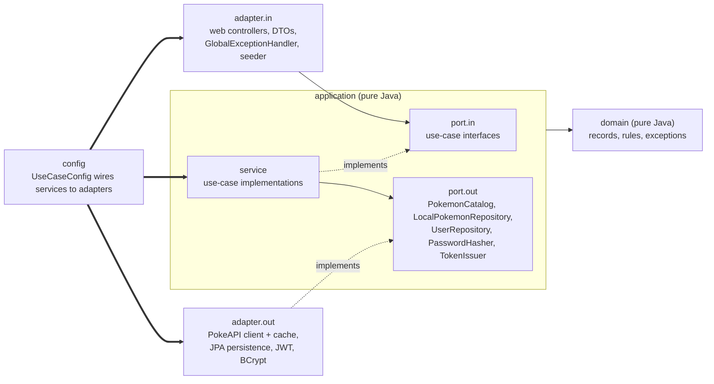

# Pokédex: Spring Boot + React

A full-stack Pokédex. A Spring Boot REST API (Clean Architecture, built test-first) reads [PokeAPI](https://pokeapi.co), caches it, lets signed-in users copy Pokémon into a local PostgreSQL collection and personalise them (local name, region, notes, tags), and a React + TypeScript frontend sits on top. Everything starts with one Docker command.

Deliverables of the exercise:

| Deliverable | Where |
|---|---|
| The application | this repository (`backend/`, `frontend/`, `docker-compose.yml`) |
| Presentation / thought process | [`docs/PRESENTATION.md`](docs/PRESENTATION.md) |
| Architecture diagrams (Mermaid) | [`docs/architecture.md`](docs/architecture.md) |
| Code tour: which files to open for each review criterion | [`docs/CODE_TOUR.md`](docs/CODE_TOUR.md) |
| GenAI section (prompt, unedited AI output, review, corrected code) | [`genai/`](genai/README.md) |
| Log of the AI prompts used to build this project | [`docs/ai-log/prompts.md`](docs/ai-log/prompts.md) |
| Plan and task breakdown | [`docs/PLAN.md`](docs/PLAN.md), [`docs/TASKS.md`](docs/TASKS.md) |

## Contents

1. [Quick start](#quick-start)
2. [Features per user story](#features-per-user-story)
3. [Tech stack](#tech-stack)
4. [Architecture](#architecture)
5. [Running it](#running-it) (Docker, local development, configuration)
6. [API reference](#api-reference)
7. [Error format](#error-format)
8. [Caching](#caching)
9. [Testing](#testing)
10. [Design decisions and trade-offs](#design-decisions-and-trade-offs)
11. [Known limitations](#known-limitations)
12. [What I would do next](#what-i-would-do-next)
13. [Repository layout](#repository-layout)

## Quick start

Requires Docker with Compose v2 and internet access (images, Maven and npm packages, PokeAPI). No Java, Node or Maven needed.

```bash
docker compose up --build
```

The first build takes a few minutes (Maven and npm downloads); after that the three containers are healthy in about 30 seconds. Then:

| What | URL |
|---|---|
| The app | http://localhost:3000 |
| Swagger UI (try the API, **Authorize** with a token from `/auth/login`) | http://localhost:8080/swagger-ui.html |
| Health | http://localhost:8080/actuator/health |

**Demo login:** username `demo`, password `demo12345` (created by Flyway migration `V2__seed_demo_user.sql`). You can also register your own account on the Register page.

On startup the backend copies Pokémon #1 to #12 from PokeAPI into the local collection in the background, so "My collection" is not empty (needs internet access; set `SEED_ENABLED=false` to skip). Stop with `Ctrl+C`; `docker compose down` removes the containers and `docker compose down -v` also deletes the database volume.

## Features per user story

| Story | What the user gets | Backend | Frontend |
|---|---|---|---|
| **US01 Enumeration** | Browse all Pokémon, 20 per page, with sprite, name, id, category, weight and abilities | `GET /api/v1/pokemon?page&size&q` (public, size capped at 50; `q` keeps names containing it, at most 50 characters) | `/` Browse page: card grid, search by part of a name (`?q=char`), pagination with the page in the URL (`?page=2`) and a "Go to page" jump, loading skeletons, error banner with retry. Each card shows the sprite, falls back to the official artwork when the sprite is missing or fails to load, then to a "?" placeholder |
| **US02 Detailed view** | Official artwork, types, height and weight, the six base stats, the English Pokédex description and the evolution tree (Eevee keeps all its branches). The tree is a tree of species; a form you open (`pikachu-gmax`) is shown in place of its species | `GET /api/v1/pokemon/{idOrName}` (public; id or lowercase name; a species name that is not a Pokémon name, such as `maushold`, resolves to the species' default form) | `/pokemon/:idOrName`: stat meters, clickable evolution tree, "Back to Browse" returns to the page and search you came from |
| **US03 Data synchronisation** | "Add to my collection" copies a Pokémon from PokeAPI into PostgreSQL. Idempotent: syncing again refreshes the PokeAPI fields and keeps the user's own fields | `POST /api/v1/local-pokemon/sync` (201 + `Location` for a new record, 200 for a re-sync), `GET /api/v1/local-pokemon`, `GET /api/v1/local-pokemon/{id}` | Button on the detail page (anonymous visitors are sent to log in and come back), `/collection` list |
| **US04 Local modification** | Edit local name, region, notes and tags of your copy (PokeAPI data is read-only); delete it. Two people editing the same record never overwrite each other silently | `PUT /api/v1/local-pokemon/{id}` (200 / 400 / 404 / 409), `DELETE /api/v1/local-pokemon/{id}` (204 / 404) | `/collection/:id/edit`: validated form with tag chips, a "edited elsewhere" banner with Reload on 409; delete with a confirmation dialog and optimistic removal |
| **Users** (the second collection) | Register, log in, stay signed in for the browser session | `POST /api/v1/auth/register`, `POST /api/v1/auth/login`, `GET /api/v1/auth/me` | `/login`, `/register`, protected routes |

Rules worth knowing (all covered by tests):

- Browsing and detail views are public. Everything under `/api/v1/local-pokemon/**` needs a JWT.
- Tags are lowercase kebab-case (`starter`, `fire-type`), at most 10 distinct tags of at most 50 characters; they are trimmed, lowercased and de-duplicated. `localName` ≤ 100, `region` ≤ 100, `notes` ≤ 1000 characters; a blank region or notes clears the field, a blank `localName` is rejected.
- `PUT` replaces all four user fields: a field left out of the body is cleared. Any other property in the body (`name`, `stats`, a typo) is a 400 that names it.
- Usernames are 3 to 50 characters from `[a-z0-9_.-]` (trimmed and lowercased, so `Demo` is `demo`); passwords are at least 8 characters and at most 72 bytes.

## Tech stack

| Area | Choice |
|---|---|
| Backend | Java 21, Spring Boot 3.5.6 (Web with `RestClient`, Data JPA, Security + OAuth2 resource server for JWT, Validation, Cache, Actuator), springdoc-openapi 2.8.17 |
| Database | PostgreSQL 16, Flyway migrations, Hibernate with `ddl-auto: validate` |
| Cache | Caffeine through Spring Cache |
| Auth | HS256 JWT (1 h), BCrypt |
| Backend tests | JUnit 5, Mockito, AssertJ, MockMvc, `MockRestServiceServer`, Testcontainers (PostgreSQL 16), ArchUnit, Cucumber 7.15 + RestAssured + WireMock, JaCoCo (report) |
| Frontend | React 19, TypeScript 5.8, Vite 6, React Router 7, TanStack Query 5 |
| Frontend tests | Vitest 3.2, Testing Library, jsdom, `@vitest/coverage-v8` (report) |
| Delivery | Multi-stage Dockerfiles (backend: Maven build, JRE alpine, non-root; frontend: Node build, nginx-unprivileged), `docker-compose.yml` with health checks |

## Architecture

Single Maven module organised as ports and adapters. Dependencies only point inward, and the rule is a failing test (`ArchitectureTest`, ArchUnit), not a convention.



- `domain` and `application` contain no Spring, JPA, Jackson or servlet imports (checked by ArchUnit). Services are plain classes created in `config/UseCaseConfig`, not `@Service` beans.
- Controllers depend on `application.port.in` interfaces only; the outbound adapters implement `application.port.out`.
- Domain exceptions (`InvalidRequestException`, `ResourceNotFoundException`, `ConflictException`, `ExternalServiceException`, `AuthenticationFailedException`) are mapped to HTTP in one place, `GlobalExceptionHandler`.

More detail, with sequence diagrams for the sync (US03) and the optimistic-locking update (US04), the Docker deployment and the data model: [`docs/architecture.md`](docs/architecture.md).

## Running it

### Docker (everything)

```bash
docker compose up --build        # foreground; add -d to detach
```

Optional settings go in a `.env` file next to `docker-compose.yml` (copy [`.env.example`](.env.example); `.env` is git-ignored, every variable has a default). In Docker the browser only talks to nginx on port 3000, which serves the React build and proxies `/api/` to the backend, so there is no CORS to configure. Swagger UI and the actuator are not proxied; use port 8080.

| Variable | Default | Meaning |
|---|---|---|
| `JWT_SECRET` | a dev-only value in the compose file | HS256 signing secret, at least 32 bytes (the backend refuses to start with less). **Set your own for anything that is not a local demo** |
| `POSTGRES_DB`, `POSTGRES_USER`, `POSTGRES_PASSWORD` | `pokedex` | Database name and credentials (shared by `db` and `backend`). Changing them after the volume exists does not change the existing database user |
| `SEED_ENABLED` | `true` | Copy Pokémon #1 to #12 into the local collection at startup |
| `FRONTEND_PORT`, `BACKEND_PORT`, `DB_PORT` | `3000`, `8080`, `5432` | Host ports; change one if it is taken (for example a local PostgreSQL on 5432) |

### Local development

Prerequisites: JDK 21, Node 20.15 or newer (the dependency versions are pinned so Node 20.15 works), Docker for the database and for the integration tests. The Maven wrapper is included, so Maven is not needed.

**1. Database** (from the repository root):

```bash
docker compose up -d db          # PostgreSQL 16 on localhost:5432, user/password/db "pokedex"
```

**2. Backend** (http://localhost:8080). Flyway creates the schema and the demo user on start; the defaults in `application.yml` match the compose database.

```powershell
# Windows PowerShell
cd backend
.\mvnw.cmd spring-boot:run
```

```bash
# macOS / Linux / Git Bash
cd backend
./mvnw spring-boot:run
```

**3. Frontend** (http://localhost:5173). The API base URL defaults to `http://localhost:8080` and can be changed with `VITE_API_URL` (see `frontend/.env.example`); the backend allows the origins `http://localhost:5173` and `http://localhost:3000`.

```bash
cd frontend
npm ci
npm run dev
```

Other frontend scripts: `npm run build` (type-check + production build), `npm run lint`, `npm test`, `npm run test:coverage`.

Backend settings (`backend/src/main/resources/application.yml`, overridable by environment variables):

| Property / env | Default | Meaning |
|---|---|---|
| `DB_URL`, `DB_USER`, `DB_PASSWORD` | `jdbc:postgresql://localhost:5432/pokedex`, `pokedex`, `pokedex` | Database |
| `JWT_SECRET` (`app.jwt.secret`), `app.jwt.ttl` | dev-only default, `1h` | Token signing and lifetime |
| `app.cors.allowed-origins` | `http://localhost:5173,http://localhost:3000` | CORS for the Vite dev server and the dockerised frontend |
| `POKEAPI_BASE_URL` (`pokeapi.base-url`) | `https://pokeapi.co/api/v2` | Upstream (the tests point it at WireMock), with 3 s connect and 10 s read timeouts |
| `SEED_ENABLED` (`app.seed.enabled`), `app.seed.pokemon-ids` | `true`, `1..12` | Demo data |

## API reference

Base path `/api/v1`. Interactive documentation and the OpenAPI document are generated from the code: Swagger UI at http://localhost:8080/swagger-ui.html, JSON at http://localhost:8080/v3/api-docs (both public).

| Method | Path | Auth | Success | Errors |
|---|---|---|---|---|
| GET | `/pokemon?page=0&size=20&q=char` | public | 200 page of `{id, name, spriteUrl, artworkUrl, category, weightKg, abilities}`; `q` (optional) keeps names containing it | 400 invalid `page`/`size`/`q`, 502 PokeAPI down |
| GET | `/pokemon/{idOrName}` | public | 200 `{id, name, imageUrl, heightM, weightKg, types, stats[], description, evolutionChain, speciesName}` | 400 malformed id, 404 unknown, 502 |
| POST | `/auth/register` `{username, password}` | public | 201 `{username, role}` | 400, 409 username taken |
| POST | `/auth/login` `{username, password}` | public | 200 `{token, expiresAt, username}` | 400, 401 (same message for unknown user and wrong password) |
| GET | `/auth/me` | token | 200 `{username, role}` (read from the token) | 401 |
| POST | `/local-pokemon/sync` `{idOrName}` | token | 201 + `Location` (new) or 200 (re-sync) with the local record | 400, 401, 404 unknown in PokeAPI, 409 concurrent first sync, 502 |
| GET | `/local-pokemon?page=0&size=20` | token | 200 page of local records, ordered by id | 400, 401 |
| GET | `/local-pokemon/{id}` | token | 200 local record | 400, 401, 404 |
| PUT | `/local-pokemon/{id}` `{localName, region, notes, tags, version}` | token | 200 record with the new `version` | 400, 401, 404, 409 stale version |
| DELETE | `/local-pokemon/{id}` | token | 204 | 400, 401, 404 |

Also public: `GET /actuator/health`. Other actuator endpoints (`info`, `caches`, `metrics`) are exposed but need a token. A page response is always `{items, page, size, totalElements, totalPages}`; `page` is zero-based.

A short session with curl (a stack from `docker compose up` is running; bash, macOS/Linux or Git Bash):

```bash
# public: one page, then Eevee with its eight evolutions
curl "http://localhost:8080/api/v1/pokemon?page=0&size=2"
curl "http://localhost:8080/api/v1/pokemon/eevee"

# log in, keep the token
TOKEN=$(curl -s -X POST http://localhost:8080/api/v1/auth/login \
  -H "Content-Type: application/json" -d '{"username":"demo","password":"demo12345"}' \
  | sed -E 's/.*"token":"([^"]+)".*/\1/')

# copy Pikachu into the collection (201 the first time), then personalise it with the version it came with
curl -i -X POST http://localhost:8080/api/v1/local-pokemon/sync \
  -H "Authorization: Bearer $TOKEN" -H "Content-Type: application/json" -d '{"idOrName":"pikachu"}'
curl -X PUT http://localhost:8080/api/v1/local-pokemon/25 \
  -H "Authorization: Bearer $TOKEN" -H "Content-Type: application/json" \
  -d '{"localName":"Sparky","region":"Kanto","notes":"Found near Viridian","tags":["electric","starter"],"version":0}'
# repeating the same PUT now answers 409: the record is at version 1
```

The same session in Windows PowerShell, where `curl` is an alias of `Invoke-WebRequest` and `&&` and `\` line continuations do not exist:

```powershell
# public: one page, then Eevee with its eight evolutions
Invoke-RestMethod "http://localhost:8080/api/v1/pokemon?page=0&size=2"
Invoke-RestMethod "http://localhost:8080/api/v1/pokemon/eevee"

# log in, keep the token
$login = Invoke-RestMethod -Method Post http://localhost:8080/api/v1/auth/login -ContentType "application/json" -Body '{"username":"demo","password":"demo12345"}'
$auth = @{ Authorization = "Bearer $($login.token)" }

# copy Pikachu into the collection (StatusCode 201 the first time), then personalise it with the version it came with
Invoke-WebRequest -UseBasicParsing -Method Post http://localhost:8080/api/v1/local-pokemon/sync -Headers $auth -ContentType "application/json" -Body '{"idOrName":"pikachu"}' | Select-Object StatusCode
Invoke-RestMethod -Method Put http://localhost:8080/api/v1/local-pokemon/25 -Headers $auth -ContentType "application/json" -Body '{"localName":"Sparky","region":"Kanto","notes":"Found near Viridian","tags":["electric","starter"],"version":0}'
# repeating the same PUT now throws a 409: the record is at version 1
```

Or use Swagger UI (**Authorize** with the token from `/auth/login`).

## Error format

Every error is `application/problem+json` (RFC 7807) with `type`, `title`, `status`, `detail` and `instance`; a 400 adds `errors: [{field, message}]` so a client can show each message next to its field. This includes errors produced before Spring MVC is reached (401 for a missing or expired token, 403) and Spring's own (malformed JSON, wrong method, type mismatch). Stack traces and Jackson messages are never sent.

```http
GET /api/v1/pokemon/NOPE!            -> 400
{"type":"about:blank","title":"Invalid request","status":400,
 "detail":"idOrName must be 1-100 lowercase letters, digits or hyphens","instance":"/api/v1/pokemon/NOPE!",
 "errors":[{"field":"idOrName","message":"idOrName must be 1-100 lowercase letters, digits or hyphens"}]}

GET /api/v1/local-pokemon (no token) -> 401, header WWW-Authenticate: Bearer
{"type":"about:blank","title":"Unauthorized","status":401,
 "detail":"Authentication is required to access this resource","instance":"/api/v1/local-pokemon"}
```

| Status | When |
|---|---|
| 400 | Invalid input: field errors (`errors[]`), malformed JSON, wrong type, unknown or read-only property in a `PUT` body |
| 401 | Missing, expired or invalid token; wrong login credentials |
| 404 | Unknown Pokémon (PokeAPI answered 404) or unknown local record |
| 409 | Username taken; stale `version` on `PUT`; two first syncs of the same Pokémon racing |
| 502 | PokeAPI unreachable, slow, or answering with an error |
| 500 | Anything unexpected, with a generic message |

## Caching

PokeAPI responses are cached in memory with Caffeine through Spring Cache, in `PokeApiClient` (`@Cacheable`): four caches, `pokeapi-list`, `pokeapi-pokemon`, `pokeapi-species` and `pokeapi-evolution`, each bounded to 5000 entries (`maximumSize=5000`) with `expireAfterWrite=6h`. PokeAPI data is effectively static, so a long TTL is safe and repeat visits never leave the server.

- The client that caches and the adapter that maps and fans out are separate beans, because Spring's `@Cacheable` proxy is bypassed by calls from inside the same class.
- A Browse page costs one list call plus two calls per Pokémon (Pokémon and species, for the category). They run in parallel on virtual threads, so the first uncached page is noticeably slower than later ones.
- A failed call is not cached (the exception propagates).
- The cache is per backend process: it is empty after a restart and not shared between instances.
- Consequence for US03: a re-sync inside the 6 h window gets the cached PokeAPI data, so "refresh" can return values that are up to six hours old.
- The frontend has its own cache in TanStack Query (5 minutes stale time, no refetch on window focus, no retry on 4xx); the edit page always refetches on open so it never submits an old `version`.

## Testing

```powershell
# Windows PowerShell, from the repository root
cd backend
.\mvnw.cmd test       # unit, web-slice, HTTP-adapter, caching, architecture: no Docker needed
.\mvnw.cmd verify     # + integration tests and Cucumber on PostgreSQL via Testcontainers (Docker required)

cd ..\frontend
npm run build; npm run lint; npm test
npm run test:coverage # optional coverage report
```

On macOS/Linux/Git Bash use `./mvnw` instead of `.\mvnw.cmd`. `mvnw verify` takes about 2.5 minutes here, most of it container and Spring start-up.

| Level | Tooling | What it covers | Count |
|---|---|---|---|
| Domain | JUnit 5, AssertJ | `PokemonIdentifier`, `PageQuery`, `User` rules, `LocalPokemon` re-sync and update | 60 |
| Application services | JUnit 5, Mockito, AssertJ | Every use case: valid path, each validation rule, not found, conflict, upstream failure, port interactions | 116 |
| Web slice | `@WebMvcTest`, MockMvc, `@MockitoBean` | Status codes, JSON shape, problem details, bean validation, public vs protected routes, expired/forged/garbage tokens, CORS, 401/403 bodies | 97 |
| Outbound HTTP | `MockRestServiceServer`, JSON fixtures in `src/test/resources/pokeapi` | PokeAPI mapping (Pikachu, Bulbasaur, branching Eevee, Ditto, Deoxys forms), 404, 5xx, cache hits, name search, species-name fallback | 24 |
| Other adapters and config | JUnit 5, `ApplicationContextRunner` | BCrypt, JWT issuing, `JwtProperties` (short secret fails start-up), demo seeder and its wiring | 43 |
| Architecture | ArchUnit | The four dependency rules listed in `docs/architecture.md` | 4 |
| **`mvn test` total** | | | **344** |
| Persistence | `@SpringBootTest` + Testcontainers PostgreSQL (`*IT`) | Flyway schema, mapping, versions, tags/abilities order, cascade delete, paging, lost-update and insert races | 18 |
| End-to-end HTTP | Testcontainers, real HTTP | Register, login and protected call; update then stale replay gives 409; OpenAPI document and Swagger UI; background seeding with a fake PokeAPI | 58 |
| Acceptance | Cucumber (6 feature files), RestAssured, WireMock as PokeAPI, Testcontainers | One feature per story (US01 to US04) plus auth and health, written in the language of the stories, with the 400/404/409 paths | 75 scenarios |
| **Extra in `mvn verify`** | | | **151** |
| Frontend | Vitest, Testing Library, jsdom | API client and problem parsing, session, auth context, protected routes, validation rules, each page including the 409 reload and the delete dialog, search and Go to page, image fallbacks; any `console.error`/`warn` fails a test | 284 (20 files) |

(The 75 Cucumber scenarios count each row of a Scenario Outline.) A separate project, [`genai/corrected`](genai/README.md), has its own 61 unit/web tests and 11 integration tests.

**Coverage** (reports only, there are no thresholds):

| | Lines | Branches | Notes |
|---|---|---|---|
| Backend | 96.8 % (852 of 880) | 81.7 % (219 of 268) | JaCoCo 0.8.13 over `mvn verify`: unit, slice, IT and Cucumber merged into one report, `backend/target/site/jacoco/index.html`. Run `clean verify` for fresh numbers (the data file is appended to). `application.service` is at 100 % of lines and branches; the weakest branch coverage is in `domain.model` (about 73 %) and the adapters (about 77 %) |
| Frontend | 97.9 % (1809 of 1847) | 93.8 % (525 of 560) | `@vitest/coverage-v8`, `npm run test:coverage`, `frontend/coverage/index.html`; 97.3 % of functions. Tests, test helpers and `main.tsx` are excluded |

Coverage is a by-product here, not a goal: the tests were written first, one rule at a time (see the TDD walkthrough in [`docs/PRESENTATION.md`](docs/PRESENTATION.md)), and every rule in the story text has a test that names it.

## Design decisions and trade-offs

| Decision | Why | Cost / alternative |
|---|---|---|
| **Clean Architecture in one Maven module, enforced by ArchUnit** | Business rules testable without Spring; the compiler cannot stop a package import but a failing test can | More types (ports, DTOs, mappers) than a three-layer CRUD would need; separate Maven modules would enforce it harder but cost build complexity |
| **Services built in `UseCaseConfig`, no `@Service`** | The application layer stays framework-free | One more file to touch per use case |
| **Local copy with the PokeAPI id as primary key** | Syncing twice is an upsert, no duplicates and no extra lookup table | The id is owned by an external system |
| **Proprietary fields live next to the replicated ones, `PUT` replaces them** | Simple contract; a re-sync overwrites only the PokeAPI columns | A partial update (`PATCH`) would need three-state fields |
| **Optimistic locking, `version` in the body** | A stale edit must fail, not overwrite (US04). Checked in the service (clear message) and again by JPA `@Version` at write time (closes the race); both give 409 | No `ETag` / `If-Match`; a header-based contract is more standard HTTP |
| **Caffeine, not Redis** | Data is static and small, one instance; no extra container | Not shared between instances, lost on restart |
| **Parallel fan-out on virtual threads** | A page of 20 needs 40 independent calls; plain Java 21, no reactive stack | The first uncached page is still slow (bounded by PokeAPI) |
| **Stateless HS256 JWT, 1 h, BCrypt** | No server session, easy to test and to proxy | No refresh token and no revocation; a deleted user's token works until it expires |
| **Login timing equalised, usernames normalised** | An unknown user would otherwise answer faster than a wrong password; `Demo` and `demo` must not be two accounts | One extra hash comparison per failed login |
| **problem+json everywhere, including the security filter chain** | One error shape for the frontend to parse | A bit of duplicate writing code for errors raised before MVC |
| **Testcontainers PostgreSQL instead of H2** | Flyway migrations, the `ON DELETE CASCADE` and the optimistic-lock behaviour run on the real database | Needs Docker for `mvn verify`; `mvn test` stays Docker-free |
| **Cucumber with WireMock for acceptance** | Specs read like the stories and run against the real HTTP stack without calling PokeAPI | About 40 s extra per `verify` |
| **TanStack Query for server state, React Context only for auth** | Caching, invalidation and optimistic delete without a store | The token is also kept in a small non-React session store so a 401 can sign the user out from plain code |
| **nginx proxy to the backend in Docker** | Same origin: no CORS, no API URL baked into the build | Swagger UI stays on port 8080 |
| **Evolution tree of species, forms shown in place** | PokeAPI's `/evolution-chain` links species; Gigantamax, Mega, gender and regional forms are varieties of one species, not evolutions. The tree marks the form being viewed (`pikachu-gmax`) at its species' node | No list of a species' forms on the detail page yet |
| **Background demo seeder** | An empty collection is a bad first impression; PokeAPI being down must not block start-up | A Pokémon deleted from the seed set returns on the next restart |

## Known limitations

These are deliberate scope decisions or open items, listed so nobody has to discover them.

- **The collection is shared, not per user.** The brief models the local store as one replica of PokeAPI data (US03) plus a separate user collection for authentication, so `local_pokemon` has no owner column (as designed in `PLAN.md`) and any signed-in user sees and edits the same records. The collection page and the delete dialog say so. Per-user collections would be the first thing to change if the product needed them.
- **Re-sync can return cached data** (6 h TTL, see Caching), so the "refreshed from PokeAPI" message is true only up to the cache age.
- **The seeder re-adds** any of #1 to #12 that a user deleted, on the next restart (`SEED_ENABLED=false` turns it off). It runs once per start and is not retried within a run.
- **Demo credentials are in a normal Flyway migration** and the demo password appears in the OpenAPI description. Fine for a demo; remove both for a real deployment. The compose file has a dev-only `JWT_SECRET` default; set your own.
- **JWT has no refresh and no revocation.** `/auth/me` is answered from the token, so a deleted user keeps a valid `/me` until expiry. The backend answers 401 to an expired token even on public routes, so the client attaches the token only to protected calls.
- **The record version travels in the body**, not in `ETag` / `If-Match`.
- **Jackson coerces scalars:** `"localName": 123` is stored as `"123"`, `"version": 1.5` becomes `1`.
- **The first uncached Browse page is slower** (1 list call + 2 calls per Pokémon), then it is cached.
- The sync is read-then-write without a lock: two simultaneous first syncs of the same Pokémon end with one 201 and one 409 ("synced concurrently, retry"), never a 500.
- The collection list is cached in the browser for the default 5 minutes, so a change made in another tab shows up on the next invalidation or reload; the "saved" notice lives in history state and reappears if that history entry is reloaded.
- Swagger UI and OpenAPI are public in every environment; `springdoc` is not switched off in any profile.
- Docker: the compose file publishes the database and backend ports for convenience; remove those mappings for anything but a laptop.
- Frontend and backend coverage were measured once, locally; there is no CI pipeline in this repository.

## What I would do next

1. **Per-user collections:** an `owner` column (or a join table), ownership enforced in the repository queries, tests that user B cannot read, change or delete user A's records.
2. **`ETag` / `If-Match` for updates** instead of the version in the body, plus `PATCH` for partial updates.
3. **Refresh tokens and token revocation**, move the token to an httpOnly cookie with CSRF protection if the frontend and API share a site.
4. **Make "refresh" real:** a cache-bypassing sync (or a shorter TTL for the sync path) so re-sync shows changed upstream data; consider a persistent or distributed cache if there is more than one instance.
5. **CI** (build, `verify`, frontend checks, a coverage gate once the numbers are trusted) and image scanning; Dockerfile layer tuning.
6. **Observability:** structured logs with a request id, Micrometer metrics for cache hit ratio and PokeAPI latency (the `caches` and `metrics` actuator endpoints are already exposed), alerting on the 502 rate.
7. **More search and filters**: Browse by type (name search exists) and the collection (by tag, region), which needs either a PokeAPI search strategy or a local index.
8. **Accessibility pass with a screen reader** and end-to-end browser tests (Playwright) on top of the component tests.

## Repository layout

```text
backend/            Spring Boot API (domain, application, adapter.in, adapter.out, config), Flyway migrations, tests
frontend/           React + TypeScript + Vite app, Dockerfile, nginx.conf
genai/              GenAI section: prompt.md, output/ (AI output as received), review.md, corrected/ (fixed code + tests)
docs/               PLAN.md, TASKS.md, PRESENTATION.md, architecture.md, CODE_TOUR.md, ai-log/prompts.md
docker-compose.yml  db + backend + frontend with health checks
.env.example        optional settings for docker compose
```

## GenAI and AI usage

- [`genai/`](genai/README.md) is the mandatory GenAI exercise: a task-management API generated from a written prompt, kept unedited, reviewed (its own tests did not compile; 13 issues logged, 7 corrected test-first or covered by new tests, 6 documented and left open), and corrected. The analysis is in [`genai/review.md`](genai/review.md).
- [`docs/ai-log/prompts.md`](docs/ai-log/prompts.md) records every prompt used to build this project with Claude Code (planning, each task, the orchestration), what came back, and what was corrected or rejected on review. [`docs/PRESENTATION.md`](docs/PRESENTATION.md) summarises how the output was checked.
