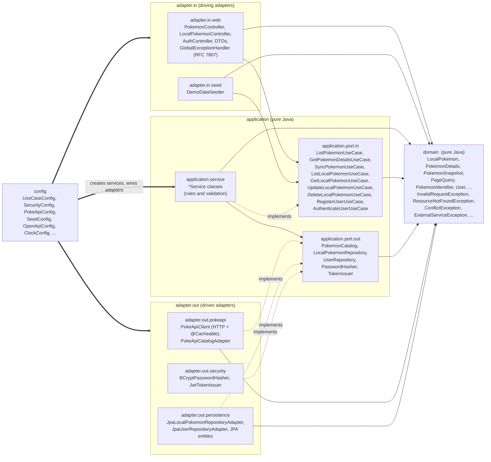
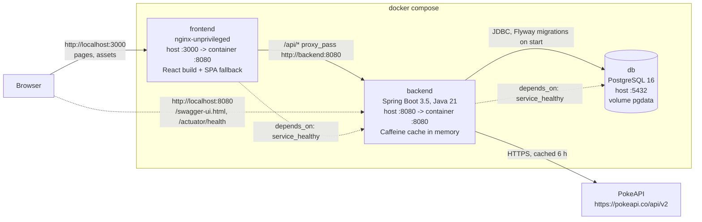
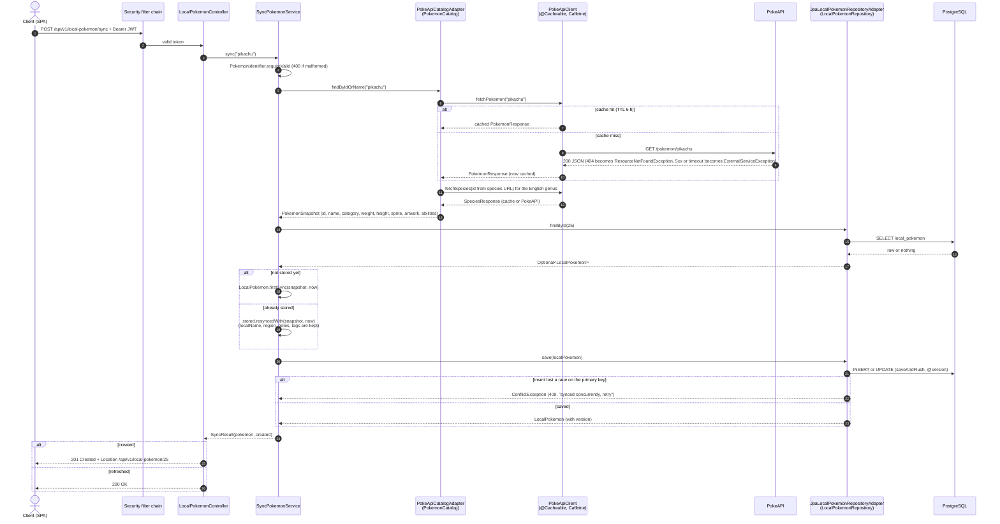
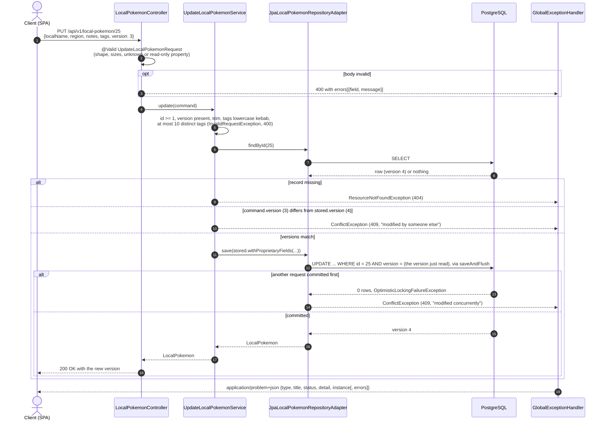
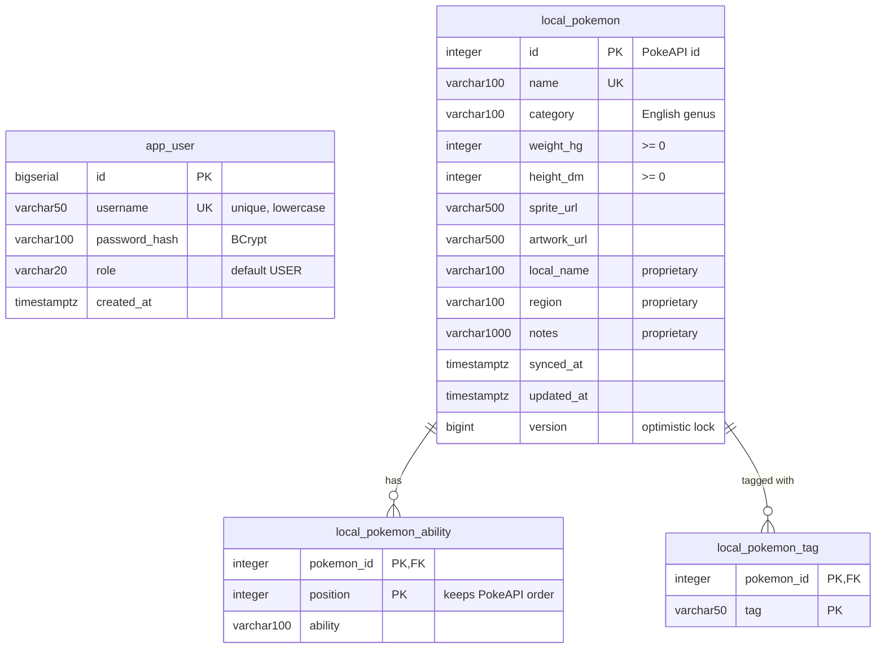

# Architecture diagrams

Mermaid diagrams (rendered by GitHub). Names are taken from the code under `backend/src/main/java/com/ilia/pokedex`; the written rationale is in the [README](../README.md) and [`PRESENTATION.md`](PRESENTATION.md), the original design in [`PLAN.md`](PLAN.md).

1. [Layers and dependency direction](#1-layers-and-dependency-direction)
2. [Deployment with Docker Compose](#2-deployment-with-docker-compose)
3. [US03 sync: PokeAPI to the local store](#3-us03-sync-pokeapi-to-the-local-store)
4. [US04 update with optimistic locking](#4-us04-update-with-optimistic-locking)
5. [Data model](#5-data-model)

## 1. Layers and dependency direction

Single Maven module, Clean Architecture (ports and adapters). Solid arrows are compile-time dependencies and all of them point towards `domain`; dashed arrows mean "implements". `config` is the only place that knows every class: it builds the services (`UseCaseConfig`) and binds them to adapters.

What `ArchitectureTest` (ArchUnit) fails the build on:

| Rule | Meaning |
|---|---|
| `layers` | `Config` is accessed by nobody; `Adapters` only by `Config`; `Application` only by `Adapters` and `Config`; `Domain` only by `Application`, `Adapters`, `Config` |
| `coreIsFrameworkFree` | `domain` and `application` may not depend on `org.springframework..`, `jakarta.persistence..`, `jakarta.servlet..` or `com.fasterxml.jackson..` |
| `inboundAdaptersDoNotTouchOutboundAdapters` | nothing in `adapter.in` depends on `adapter.out` (a controller cannot call the PokeAPI client or a JPA repository) |
| `webUsesUseCasesNotServices` | nothing in `adapter.in` depends on `application.service`, only on the `port.in` interfaces |

## 2. Deployment with Docker Compose

`docker compose up --build` starts three containers. The browser talks only to nginx on port 3000: it serves the React build and proxies `/api/` to the backend, so the browser sees one origin (no CORS in Docker). Swagger UI and the actuator are served by the backend directly on port 8080 and are deliberately not proxied.

Health checks: `db` runs `pg_isready`, `backend` calls `/actuator/health`, `frontend` fetches `/`. Settings come from `.env` (see `.env.example`).

## 3. US03 sync: PokeAPI to the local store

`POST /api/v1/local-pokemon/sync` with `{"idOrName": "pikachu"}`. The security filter chain runs first (a missing, expired or forged token is a 401 `problem+json` and the controller is never reached). The service depends only on the two outbound ports; the cache sits in `PokeApiClient`, below the mapping adapter.

Errors on the way out are mapped once, by `GlobalExceptionHandler`: `InvalidRequestException` 400, `ResourceNotFoundException` 404, `ConflictException` 409, `ExternalServiceException` 502, anything else 500 with a generic message.

## 4. US04 update with optimistic locking

`PUT /api/v1/local-pokemon/{id}` carries the `version` the client last read. A stale version is rejected in two places: the service compares it before writing (cheap, descriptive message), and the adapter translates JPA's `OptimisticLockingFailureException` for the race between the check and the write. Both end as the same domain `ConflictException`, so a conflict is never a 500.

The frontend turns a 409 into a banner ("edited elsewhere") with a Reload button that refetches the record and restarts the form from it; Save stays disabled until then.

## 5. Data model

Flyway `V1__init.sql` (schema) and `V2__seed_demo_user.sql` (demo account). `local_pokemon.id` is the PokeAPI id, so syncing the same Pokémon twice is an upsert. There is no owner column: the collection is shared by all users (see the limitations in the README). The ability and tag tables are element collections of `LocalPokemonEntity` and are removed with the row (`ON DELETE CASCADE`).

`app_user` and `local_pokemon` are unrelated tables on purpose: users authenticate, the collection is not owned.
